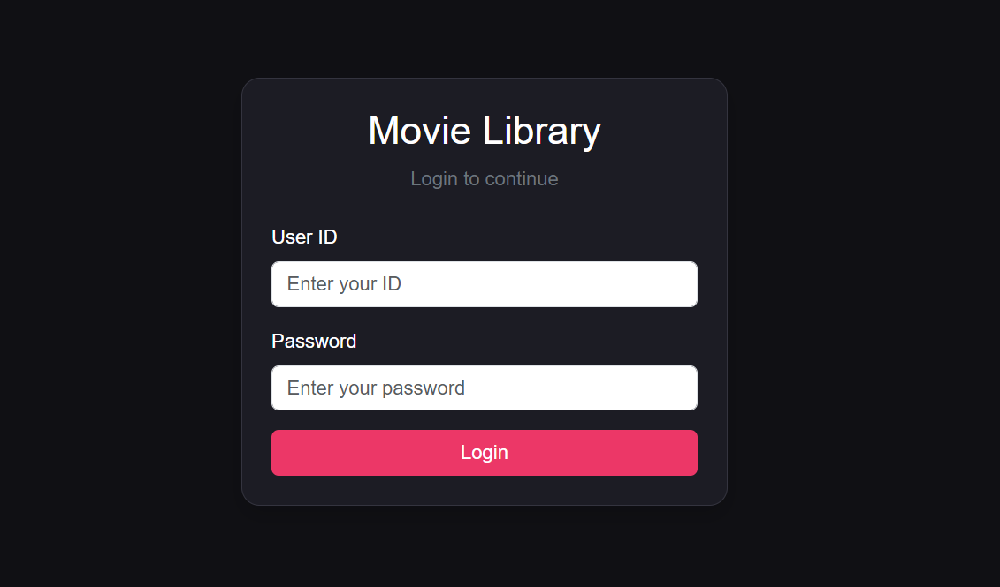
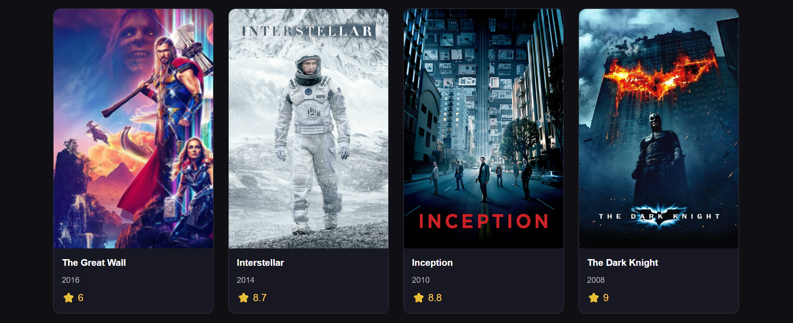
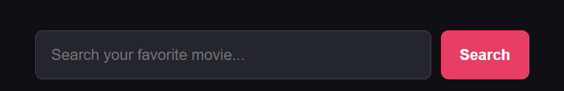
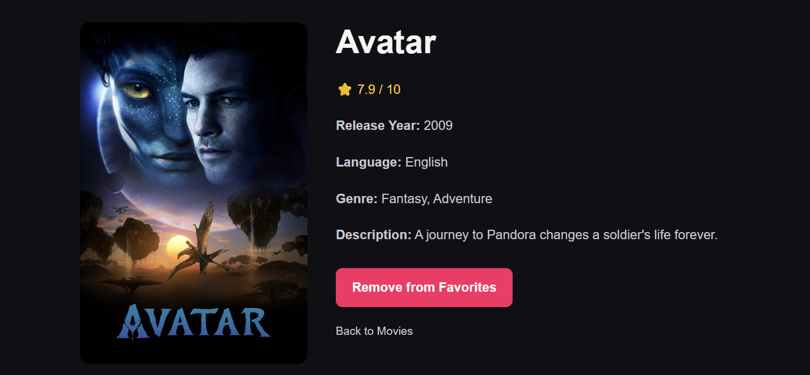
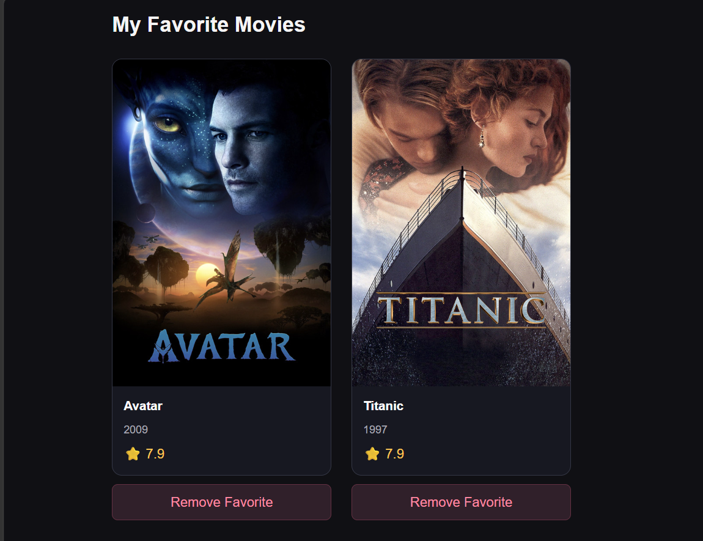
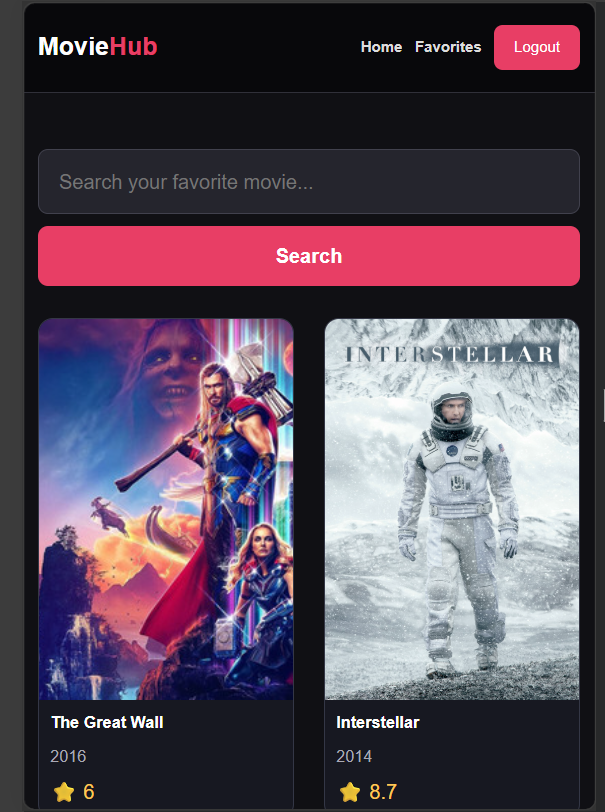

# 🎬 MovieHub – Movie Library App

**A responsive movie library web app where users can log in, explore movies, search by title, view details and build their own favorites list.**


---

## 📑 Table of Contents

- [About the Project](#-about-the-project)
- [Features](#-features)
- [Screenshots](#-screenshots)
- [Tech Stack](#-tech-stack)
- [Project Structure](#-project-structure)
- [Getting Started](#-getting-started)
- [Available Scripts](#-available-scripts)
- [Demo Login Credentials](#-demo-login-credentials)
- [App Routes](#-app-routes)
- [API Endpoints](#-api-endpoints-json-server)
- [How It Works](#-how-it-works)
- [Responsive Design](#-responsive-design)
- [Known Limitations](#-known-limitations)
- [Future Improvements](#-future-improvements)
- [What I Learned](#-what-i-learned)
- [Author](#-author)

---

## 📖 About the Project

**MovieHub** is a front-end project built to practice real-world React concepts such as component-based design, global state management with Redux Toolkit, client-side routing with protected pages, and working with a REST API.

The app fetches movie data from a local **JSON Server** (`db.json`). After logging in, a user can browse the movie collection, search for a movie, open its details page and save movies to a personal favorites list that stays saved even after refreshing the browser.

---

## ✨ Features

### 🔐 Authentication
- Login with User ID and Password (verified against the `users` data in JSON Server)
- Logged-in user is stored in `localStorage`
- Logout button in the navbar
- Already logged-in users are automatically redirected away from the login page

### 🛡️ Protected Routes
- `PrivateRoute` guards the Home, Movie Details and Favorites pages
- Unauthenticated users are redirected to `/login`
- Unknown URLs redirect to the home page

### 🎞️ Browse & Search
- Movie grid with poster, title, release year and rating
- Search movies by keyword using the search bar
- "No movies found" message when a search has no results
- Loading and error messages while data is being fetched

### 📄 Movie Details
- Large poster with rating out of 10
- Release year, language, genre and description
- Add to / remove from favorites directly from the details page
- "Back to Movies" link

### ❤️ Favorites
- Dedicated **My Favorite Movies** page
- Remove any movie from favorites with one click
- Favorites are saved in `localStorage`, so they persist after a page reload

### 🖼️ UI / UX
- Dark, modern theme with a pink accent colour
- Hover animation on movie cards
- Fallback placeholder image if a poster fails to load
- Fully responsive layout for desktop, tablet and mobile

---

## 📸 Screenshots

### 🔑 Login Page


### 🏠 Home Page


### 🔍 Search Results


### 🎥 Movie Details Page


### ❤️ Favorites Page


### 📱 Mobile View


---

## 🛠️ Tech Stack

| Category | Technology | Purpose |
| --- | --- | --- |
| Library | **React.js** | Building the user interface with components |
| Build Tool | **Vite** | Fast development server and bundling |
| State Management | **Redux Toolkit**, **React-Redux** | Global movies and favorites state |
| Routing | **React Router DOM** | Page navigation and protected routes |
| Styling | **CSS3**, **Bootstrap** | Custom dark theme and responsive layout |
| Mock Backend | **JSON Server** | REST API for movies and users |
| Browser Storage | **localStorage** | Login session and favorites persistence |
| Code Quality | **ESLint** | Linting and consistent code style |

---

## 📁 Project Structure

```
Movie-Library/
├── public/
├── src/
│   ├── assets/
│   │   ├── Screenshot/
│   │   │   ├── favorites.png
│   │   │   ├── home.png
│   │   │   ├── login.png
│   │   │   ├── mobile.png
│   │   │   ├── movie-details.png
│   │   │   └── search.png
│   │   ├── hero.png
│   │   ├── react.svg
│   │   └── vite.svg
│   ├── components/
│   │   ├── Favorites.jsx
│   │   ├── Login.jsx
│   │   ├── MovieCard.jsx
│   │   ├── MovieDetails.jsx
│   │   ├── MovieList.jsx
│   │   ├── MovieSearch.jsx
│   │   ├── Navbar.jsx
│   │   └── PrivateRoute.jsx
│   ├── redux/
│   │   ├── moviesSlice.js
│   │   └── store.js
│   ├── utils/
│   │   └── tmdb.js
│   ├── App.jsx
│   ├── main.jsx
│   └── style.css
├── .gitignore
├── db.json
├── eslint.config.js
├── index.html
├── package-lock.json
├── package.json
├── vite.config.js
└── README.md
```

### 🧩 Component Overview

| Component | Responsibility |
| --- | --- |
| `App.jsx` | Defines all routes and the Home page (fetches and displays movies) |
| `Login.jsx` | Login form, user verification and session creation |
| `PrivateRoute.jsx` | Blocks access to protected pages when not logged in |
| `Navbar.jsx` | Navigation links, login/logout button |
| `MovieSearch.jsx` | Search input and submit handling |
| `MovieList.jsx` | Reads movies from Redux and renders the grid |
| `MovieCard.jsx` | Single movie card with link to the details page |
| `MovieDetails.jsx` | Fetches and shows full details of one movie |
| `Favorites.jsx` | Lists favorite movies with a remove option |
| `moviesSlice.js` | Redux slice: `setMovies` and `toggleFavorite` |
| `tmdb.js` | API helper functions (`getPopularMovies`, `searchMovies`, `getMovieDetails`) |

---

## 🚀 Getting Started

### Prerequisites

- [Node.js](https://nodejs.org/) (v18 or higher recommended)
- npm (comes with Node.js)
- Git

### 1. Clone the repository

```bash
git clone https://github.com/nirmaldholu4/Movie-Library-App.git
cd Movie-Library-App/Movie-Library
```

### 2. Install dependencies

```bash
npm install
```

If any package is missing, install it manually:

```bash
npm install react-router-dom @reduxjs/toolkit react-redux bootstrap
npm install -D json-server@0.17.4
```

### 3. Start JSON Server (Terminal 1)

```bash
npx json-server --watch db.json --port 3000
```

The API will run at **http://localhost:3000**.

### 4. Start the React app (Terminal 2)

```bash
npm run dev
```

Open the URL shown in the terminal (usually **http://localhost:5173**).

> ⚠️ **Important:** JSON Server must be running before you use the app. Otherwise login and movie loading will fail with a "Server error" message.

---

## 📜 Available Scripts

| Command | Description |
| --- | --- |
| `npm run dev` | Starts the Vite development server |
| `npm run build` | Creates a production build |
| `npm run preview` | Previews the production build locally |
| `npm run lint` | Runs ESLint on the project |
| `npx json-server --watch db.json --port 3000` | Starts the mock API |

---

## 🔑 Demo Login Credentials

| User ID | Password | Name |
| --- | --- | --- |
| `nirmal` | `12345` | Nirmal |
| `admin` | `admin123` | Admin |
| `movieuser` | `movie123` | Movie User |

---

## 🧭 App Routes

| Path | Page | Access |
| --- | --- | --- |
| `/login` | Login page | Public |
| `/` | Home – movie list and search | 🔒 Logged-in only |
| `/movie/:id` | Movie details | 🔒 Logged-in only |
| `/favorites` | My favorite movies | 🔒 Logged-in only |
| `*` | Any other URL | Redirects to `/` |

---

## 🔌 API Endpoints (JSON Server)

Base URL: `http://localhost:3000`

| Method | Endpoint | Description |
| --- | --- | --- |
| `GET` | `/movies` | Get all movies |
| `GET` | `/movies?q=<keyword>` | Search movies by keyword |
| `GET` | `/movies/:id` | Get a single movie by ID |
| `GET` | `/users` | Get all users (used for login verification) |

### Movie object structure

```json
{
  "id": 2,
  "title": "Interstellar",
  "year": 2014,
  "poster": "https://image.tmdb.org/t/p/w500/gEU2QniE6E77NI6lCU6MxlNBvIx.jpg",
  "rating": 8.7,
  "language": "English",
  "genre": "Sci-Fi, Drama",
  "description": "A team of explorers travels beyond this galaxy to discover a future for humanity."
}
```

---

## 🧠 How It Works

### 1. Login flow
1. User enters ID and password in `Login.jsx`.
2. The app fetches `/users` and looks for a matching ID and password.
3. On success, `{ id, name }` is saved in `localStorage` under `loggedInUser` and the user is taken to the home page.
4. On failure, an "Invalid ID or Password!" message is shown. If the server is off, a "Server error" message is shown instead.

### 2. Route protection
`PrivateRoute.jsx` checks `localStorage` for `loggedInUser`. If it is missing, the user is redirected to `/login`; otherwise the requested page is rendered through React Router's `<Outlet />`.

### 3. Loading and searching movies
The `Home` component calls `getPopularMovies()` on first load, or `searchMovies(query)` when the user searches. The result is dispatched to Redux using `setMovies`, and `MovieList` reads it from the store.

### 4. Favorites
`toggleFavorite` in `moviesSlice.js` checks whether the movie is already in the list. If it is, the movie is removed; if not, it is added. After every change the list is synced to `localStorage`, and the initial state is loaded from it on startup.

### 5. Redux state shape

```js
{
  movies: {
    movies: [],      // movies currently displayed on Home
    favorites: []    // saved favorites (synced with localStorage)
  }
}
```

---

## 📱 Responsive Design

| Screen width | Columns |
| --- | --- |
| Above 1000px | 4 |
| 1000px and below | 3 |
| 700px and below | 2 |
| 450px and below | 1 |

The navbar, hero section, search bar and details page also adapt for tablets and mobile phones.

---

## ⚠️ Known Limitations

- Passwords are stored in plain text in `db.json` – this is **only for learning/demo purposes** and must never be used in a real application.
- Authentication is client-side only (no tokens or server-side sessions).
- Favorites are stored per browser, not per user account.
- Requires JSON Server to be running locally; there is no deployed backend yet.

---

## 🔮 Future Improvements

- [ ] Connect to the real **TMDb API**
- [ ] Secure authentication with a real backend (hashed passwords, JWT)
- [ ] Sign-up / registration page
- [ ] Per-user favorites
- [ ] Watchlist feature
- [ ] Pagination or infinite scroll
- [ ] Filter by genre, year and rating
- [ ] Sort movies by rating or release year
- [ ] Dark / light theme toggle
- [ ] Deploy the app (Vercel / Netlify) with a hosted API

---

## 🎓 What I Learned

- Structuring a React app into reusable components
- Managing global state with **Redux Toolkit** (slices, reducers, selectors)
- Building **protected routes** with React Router
- Fetching data with the **Fetch API** and handling loading and error states
- Persisting data with **localStorage**
- Creating a responsive layout using CSS Grid, media queries and Bootstrap
- Working with a mock REST API using **JSON Server**

---

## 👨‍💻 Author

**Nirmal Dholu**
Frontend Developer (React.js) · Rajkot, Gujarat, India

- 🔗 GitHub: [nirmaldholu4](https://github.com/nirmaldholu4)
- 💼 LinkedIn: [dholu-nirmal](https://www.linkedin.com/in/dholu-nirmal/)
- 📧 Email: nirmaldholu4@gmail.com

---

<div align="center">

⭐ If you like this project, please give it a star on GitHub!

*This project is created for learning.*

</div>
